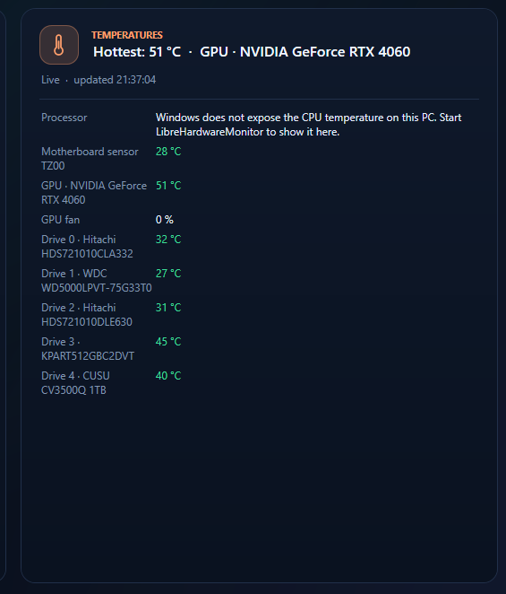

# CyberDisk

**[⬇ Download CyberDisk.exe](https://github.com/CJXIS/CyberDisk/releases/latest/download/CyberDisk.exe)** - one file, no installer (Windows 10 / 11). [All releases](https://github.com/CJXIS/CyberDisk/releases)

**A fast, all-in-one Windows toolbox: disk analyzer, cleaner, app uninstaller, PC booster, health checker and hardware viewer.**

One small `.exe` (WPF, .NET Framework 4.8) for Windows 10 / 11. English and Arabic (with full right-to-left layout).

By **Ahmad Qashqesh** · [ahmadrqash@gmail.com](mailto:ahmadrqash@gmail.com) · [LinkedIn](https://linkedin.com/in/ahmadrq)

<!-- screenshots:start -->
## Screenshots

<p align="center">
  
</p>
<!-- screenshots:end -->

## What it does

| Area | Highlights |
|---|---|
| **Drives** | Live capacity of every drive, deep scan of any folder, largest files and folders. |
| **Disk Health** | Per-disk health score, temperature, wear, SMART data, volumes and partitions. Export as PDF or picture. |
| **Apps** | Installed apps, games and Store apps with install date, size and advanced details. Uninstall with a reviewed leftovers cleanup. |
| **Clean** | System junk, Windows Disk Cleanup, browser data and app caches - analyze first, then clean. |
| **Boost** | Release idle memory, review heavy processes and startup apps. |
| **Health** | One-click PC check (updates, file system, drivers, services, security) with a fix button for each finding. |
| **Errors** | App crash and hang history from the Windows event log. |
| **My PC** | Live temperatures, processor (base, current and measured max clock), memory, graphics, motherboard, storage, displays (refresh rate, colour depth, HDR), network, OS, battery and security. Selectable text, export as PDF / picture / text. |

## Windows says "Windows protected your PC"?

New programs that are not signed with a paid code-signing certificate show a blue **SmartScreen** notice until enough people have downloaded them. It does not mean the file is harmful. CyberDisk is open source: every line is in this repository.

1. Click **More info**, then **Run anyway**.
2. To be sure the file is the one published here, compare its SHA-256 with the value in the release notes:
   `Get-FileHash .\CyberDisk.exe -Algorithm SHA256`

CyberDisk asks for administrator rights because disk health, cleanup and repairs need them.

## Build

Requirements: Windows 10/11 and the .NET SDK (any version that can target .NET Framework 4.8).

```powershell
git clone https://github.com/CJXIS/CyberDisk.git
cd CyberDisk
dotnet build -c Release
```

The SDK compiles every `.cs` file in the sub-folders automatically. The app asks for administrator rights because disk health and cleanup need them.

## Project layout

| Folder | What lives there |
|---|---|
| `Program.cs` | Entry point (`--tray` starts hidden in the system tray). |
| `Core/` | Shared building blocks: `Obs`, `Wmi`, `Native` (Win32), `DisplayCfg` (monitor info), `Vec` (vector icons), `Settings`. |
| `Models/` | Plain data and view-model classes. |
| `Services/` | All logic without UI: scanning, cleanup, app inventory, health check, disk and hardware readers. |
| `Localization/` | Translation engine and the Arabic dictionary. |
| `Ui/` | The main window, split by feature as `partial class Ui`. `Ui.Xaml.cs` holds the window markup. |

## Where to change things

* **A score colour or grade** - `Models/ScoreTheme.cs`.
* **How the health score is calculated** - `Services/HealthScorer.cs`.
* **What a health fix does** - `Services/Fixer.cs`.
* **Drive health rules** - `DiskInfo.Assess` in `Services/DiskInfo.cs`.
* **A new Arabic string** - add `A("English", "العربية");` in `Localization/Loc.Arabic.cs`.
* **An icon** - add a path to `Core/Vec.cs`.

## Publishing a release

```powershell
powershell -ExecutionPolicy Bypass -File tools\release.ps1 -Version 1.4.2
```

Builds `CyberDisk.exe`, writes its SHA-256, pushes the code, tags it and creates the GitHub release (with the GitHub CLI) or opens the release page so the .exe can be dragged onto it. The notes come from the matching section of `CHANGELOG.md`.

## Contributing

Questions, ideas and bug reports are welcome - open an issue or write to the email above.

See [CHANGELOG.md](CHANGELOG.md) for what changed in each version.
